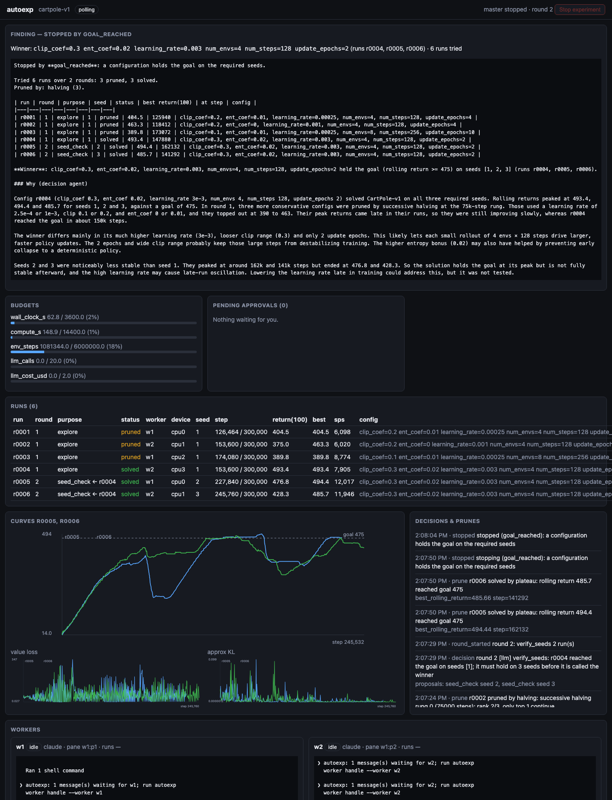

# auto_experiment

A master/worker system for reinforcement-learning experiments on one machine.
One master decides what to run, watches runs while they train, prunes weak
ones and decides the next step; workers in Herdr panes execute and debug the
runs; a local dashboard shows what has happened.

The design is in [docs/architecture.md](docs/architecture.md).



## How it works

- `autoexp up` starts the **master**: it takes the master lock, opens one
  Herdr pane per **worker** (Claude Code by default), and serves the
  **dashboard** on `http://127.0.0.1:8765/`.
- Every experiment gets a **run ID** (`r0001`, ...). Commands, logs,
  checkpoints, telemetry and dashboard rows are keyed by it.
- The master steers workers through **durable inbox files** and a nudge typed
  into their pane; workers report back as **event lines**. Each assigned run
  is executed by a detached **run supervisor** that holds the run lock and a
  device lock, so a run is never driven twice and two runs never share a
  device.
- Each tick the master **observes** telemetry (JSONL), **prunes** (divergence,
  plateau, successive halving / ASHA, optional LLM judge), checks **budgets and
  stop rules**, and when a round has settled **decides** the next one (LLM
  proposal with a deterministic fallback; a solver is always re-run on fresh
  seeds before it is called the winner).
- Training-code changes and budget overruns become **pending approvals** on the
  dashboard; the loop keeps going meanwhile.
- Everything lives under the state directory, so killing and restarting the
  master recovers every run. Anything a human types into a worker pane wins
  over the master.

## Prerequisites

Tested on macOS (Apple Silicon, CPU only). Linux should work; Windows does not
(the locks use `flock`).

| Tool | Version | Needed for |
|---|---|---|
| Python | 3.11 or newer (3.12 recommended) | everything |
| [uv](https://docs.astral.sh/uv/) | 0.6 or newer | creating the virtualenv and installing |
| Node.js | 20 or newer | only the dashboard frontend tests (`npm test`); the dashboard itself needs no Node |
| Herdr | 0.7 or newer | worker panes (`autoexp up` without `--no-herdr`) |
| Claude Code (`claude`) | 2.x | agent workers (`workers.runtime = "claude"`) and the LLM decision engine (`llm.engine = "llm"`) |

**Authentication.** autoexp holds no API keys. The master's LLM calls run
`claude -p --output-format json` and each agent worker runs `claude` in its
pane, so both use whatever Claude Code is logged in with. Run `claude` once
and log in before `autoexp up`. LLM usage is metered against the
`[budget] llm_calls` and `llm_cost_usd` limits.

**Without an LLM or Herdr**, everything except the LLM proposals, the LLM
judge and agent debugging still works: `--engine deterministic` uses the
deterministic decision engine, `--runtime shell` uses a plain worker loop
instead of Claude Code, and `--no-herdr` lets you start those workers in
ordinary terminals (see below).

## Install

```sh
git clone https://github.com/chaitu0032/auto_experiment.git
cd auto_experiment
uv venv --python 3.12 .venv
uv pip install --python .venv/bin/python -e ".[train,dev]"
.venv/bin/autoexp --help
```

`train` pulls in PyTorch, Gymnasium and NumPy for the bundled CartPole PPO
trainer; `dev` adds pytest.

## Configure

An experiment is one TOML file. [`configs/cartpole.toml`](configs/cartpole.toml)
is the first milestone (4 CartPole PPO configurations), with defaults sized
for an Apple M1 with 8 cores and 16 GB of memory. Its sections:

| Section | Controls |
|---|---|
| `experiment_id` | name of the experiment; its state lives in `autoexp-state/<experiment_id>/` |
| `[trainer]` | the training command, run once per run with `--run-dir --run-id --config --device --seed --total-steps --threads`, and `total_steps` per run |
| `[goal]` | the metric to maximise (`rolling_return` over `window` episodes), the `threshold` that counts as solved, and `seeds_required` fresh seeds a winner must also solve |
| `[search_space]` | hyperparameters the master may vary when it forks or explores (`log_float`, `float`, `int`, `choice`) |
| `[[initial_configs]]` | the configurations of round 1, one run each |
| `[pruning]` | rule order, plus `divergence` (KL and value-loss blow-up), `plateau` (no gain over `patience_steps`), `halving` (`sync` successive halving or `async` ASHA, with `rungs` as fractions of `total_steps` and `eta`), and `llm_judge` (off by default) |
| `[budget]` | hard limits: `wall_clock_s`, `compute_s`, `env_steps`, `llm_calls`, `llm_cost_usd`; going past one needs your approval |
| `[stop]` | when the loop ends: `max_rounds`, `no_improvement_rounds` (rounds whose best return grew by less than `min_improvement`), `crash_limit`, and `stop_on_llm_budget` |
| `[workers]` | `count` workers, `runs_per_worker`, the `runtime` (`claude` or `shell`) and the `agent_command` that starts Claude Code |
| `[devices]` | device `slots` (one run per slot at a time), `threads_per_slot`, `max_concurrent_runs` |
| `[herdr]` | the Herdr command prefix, `session` name and workspace label |
| `[llm]` | `engine` (`llm` or `deterministic`), the headless Claude command and its timeout |
| `[master]` | `tick_s`, how often the master observes, prunes and decides |
| `[dashboard]` | host and port of the dashboard |

`autoexp up --engine`, `--runtime` and `--port` override the matching config
values for one start. To try a change quickly, copy the file and lower
`trainer.total_steps`, `pruning.plateau.min_steps` and `stop.max_rounds`.

## Run the first milestone

### With Herdr and Claude Code workers

1. Start (or attach to) the Herdr session the config names:

   ```sh
   herdr --session autoexp
   ```

2. In another terminal, from the repository root:

   ```sh
   .venv/bin/autoexp up --config configs/cartpole.toml
   ```

   It prints `dashboard: http://127.0.0.1:8765/` and the state directory, then
   logs every master event (decisions, allocations, prunes, stop) as it
   happens. The master creates an `autoexp` workspace in Herdr with one pane
   per worker; each pane runs Claude Code started with the worker brief.
3. Open the dashboard URL in a browser. It shows each run's status, curves,
   budgets, pending approvals, worker panes and the event log, and updates
   live.

To point the master at a different Herdr session, set `herdr.session` in the
config; to call Herdr through a wrapper, set `AUTOEXP_HERDR_COMMAND` to the
command prefix to use.

### Without Herdr or an LLM

```sh
.venv/bin/autoexp up --config configs/cartpole.toml --no-herdr --engine deterministic --runtime shell
```

Then start each worker in its own terminal:

```sh
.venv/bin/autoexp worker serve --worker w1
.venv/bin/autoexp worker serve --worker w2
```

A shell worker launches assigned runs and applies stop requests by itself;
type `help` in it for its commands.

### While it runs

Run these from the repository root, in any terminal:

```sh
.venv/bin/autoexp status                      # runs, budgets, pending approvals, the finding
.venv/bin/autoexp approve <approval_id>       # or: reject <approval_id> [--note "why"]
.venv/bin/autoexp stop                        # ask the master to stop on its next tick
.venv/bin/autoexp pane read w1 --lines 40     # what worker w1's pane shows (Herdr only)
.venv/bin/autoexp pane send w1 "text"         # type into w1's pane as the master (Herdr only)
.venv/bin/autoexp dashboard --port 8765       # serve the dashboard alone for an existing state
```

**Human takeover.** Anything you type into a worker pane overrides the master.
Mark it so the master stops typing into that pane, and release it when done:

```sh
.venv/bin/autoexp worker takeover w1 on
.venv/bin/autoexp worker takeover w1 off
```

The dashboard has the same takeover, approve/reject and stop controls.

The master stops when a stop rule or budget says so, when a winner has been
verified on fresh seeds, or on `autoexp stop`. It then prints the finding (a
summary table of every run) and writes it to `finding.md`. Restarting
`autoexp up` with the same config recovers a running experiment from disk; on
a finished one it reports that the experiment has already finished. To start
over, remove or rename its state directory.

## What a run produces

All state is plain files under `autoexp-state/<experiment_id>/` (change the
root with `--state-dir`):

```text
experiment.json, counters.json   the experiment and its config; ID counters
finding.md, finding.json         the final finding
STOP                             present once a stop was requested
master/events.jsonl              every master event (what the dashboard log shows)
master/budget.json               latest budget usage
master/summaries.json            latest curve summary per run
master/heartbeat.json            master liveness
locks/                           master, run-<run_id> and device-<slot> locks
runs/<run_id>/spec.json          the run's config, seed, device and purpose
runs/<run_id>/events.jsonl       allocated, assigned, launched, started, stop_requested, exited
runs/<run_id>/metrics.jsonl      trainer telemetry (returns, losses, KL, entropy, ...)
runs/<run_id>/stdout.log         trainer stdout and stderr
runs/<run_id>/supervisor.log     run supervisor output
runs/<run_id>/control.json       a stop request, when there is one
runs/<run_id>/checkpoints/       trainer checkpoints
workers/<worker_id>/             worker.json, BRIEF.md, events.jsonl, inbox/, pane.json, takeover
approvals/                       pending and answered approvals
```

Any program that follows the trainer contract in
[`src/autoexp/trainers/base.py`](src/autoexp/trainers/base.py) (write
telemetry JSONL, honour SIGTERM) can replace the bundled PPO trainer.

## Tests

```sh
.venv/bin/python -m pytest -q          # Python: deterministic parts, no Herdr or LLM needed
npm test                               # dashboard frontend modules (node --test, no dependencies)
uvx ruff check src tests && uvx ruff format --check src tests
```

## Troubleshooting

- **`autoexp: lock master.lock is held by pid ...` (exit code 3).** Another
  master already runs this experiment. Stop it first; there is only one master
  per experiment.
- **``no experiment state under ...; run `autoexp up` first``.** `status`, `stop`
  and the other commands look for state under `autoexp-state/`. Run them from
  the directory you ran `autoexp up` in, or pass `--state-dir`.
- **`several experiments under ...`.** Pass
  `--state-dir autoexp-state/<experiment_id>`.
- **`herdr command not found`.** Install Herdr or put it on `PATH`, set
  `AUTOEXP_HERDR_COMMAND`, or use `--no-herdr`.
- **Workers sit idle in their panes.** Check that Claude Code is logged in
  (run `claude` in a terminal) and read the pane with `autoexp pane read <worker>`.
- **The dashboard port is busy.** Start with `--port <n>`, or change
  `[dashboard] port`.
- **A run crashed.** Read `runs/<run_id>/stdout.log`; agent workers get a
  debug message with the traceback and report back through
  `autoexp worker report`.

## Layout

```text
docs/architecture.md   the design
configs/cartpole.toml  first milestone: 4 CartPole PPO configurations
src/autoexp/
  core/        run/worker/device ids, data models
  config/      typed config schema and loader
  state/       state layout, JSONL logs, registry, locks, inbox, approvals, recovery
  telemetry/   trainer-side writer, incremental reader, curve summaries
  observe/     observability: telemetry + logs + pane context -> observations
  pruning/     divergence, plateau, successive halving / ASHA, LLM-judge seam
  decision/    verification protocol, deterministic engine, LLM engine seam, validation
  budget/      budget ledger, stop rules
  llm/         the single metered LLM gateway
  herdr/       Herdr adapter (CLI), a null adapter, and a fake for tests
  master/      control loop and its phases, scheduler, steering, panes, finding
  worker/      pane runtimes, inbox handler, shell worker loop, run supervisor, brief
  trainers/    trainer contract, CleanRL-style PPO for CartPole
  dashboard/   Python JSON API over the state directory (routes, handlers, schemas)
    web/       JavaScript frontend: index.html, ES modules, SVG charts (no build step)
tests/         Python tests; tests/web/ holds frontend tests run with node --test
```

## License

MIT, see [LICENSE](LICENSE).
