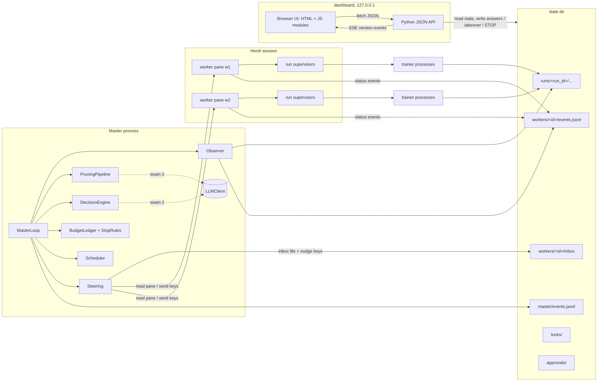

# auto_experiment architecture (v1)

Status: **implemented**. The design was reviewed and approved as a skeleton
(revision 2); `src/autoexp/` now implements it. Where the build added detail,
this document says so.

## 1. What it is

A master/worker system that runs reinforcement-learning experiments on one
machine, watches them while they train, prunes weak ones, decides what to run
next, and keeps the user informed through a local dashboard.

- **One master** (the brain) decides which experiments run and interprets
  results. It never trains anything itself.
- **Workers** (the hands) execute what the master assigned. Each worker lives in
  its own Herdr pane and is, by default, an AI coding agent (Claude Code) that
  can debug its own runs. Workers talk only to the master, never to each other.
- **Everything durable is a file.** The master keeps no state that is not on
  disk, so it can crash, restart, and pick up every run where it was.

The control plane borrows firstmate's shape: a single supervisor with an
exclusive lock, durable per-worker inbox files for steering, append-only status
event lines going back up, the supervisor reading and typing into worker panes,
and human input in a pane always winning over the supervisor.

First milestone: the master runs 4 CartPole PPO configurations (2 worker panes
x 2 runs each), prunes, launches at least one follow-up round, verifies a
winner on 3 seeds, and stops by its stop rules.

## 2. Deterministic code versus LLM

The LLM is never in the control path. It sits behind exactly three seams, each
with a deterministic implementation or fallback, and every LLM output is
validated by deterministic code before it has any effect.

| Concern | Implementation | LLM? |
|---|---|---|
| Master control loop, scheduling, steering | `master/loop.py`, `master/phases.py`, `master/policy.py`, `master/scheduler.py`, `master/steering.py` | no |
| Verification protocol (re-run a solver on fresh seeds, stop on a verified winner) | `decision/deterministic.py` `protocol_decision` | no, shared by every engine |
| Locks (master, run, device) | `state/locks.py` | no |
| Run registry, event folding, recovery | `state/registry.py`, `state/recovery.py` | no |
| Worker inbox, approvals | `state/inbox.py`, `state/approvals.py` | no |
| Telemetry parsing and curve summaries | `telemetry/` | no |
| Plateau / divergence / successive-halving / ASHA pruning | `pruning/rules.py`, `pruning/halving.py` | no |
| Budgets and stop rules | `budget/` | no |
| Dashboard (Python JSON API + JavaScript UI) | `dashboard/`, `dashboard/web/` | no |
| **Seam 1: decision proposal** (which configs to explore next, final narrative) | `decision/llm.py` behind `DecisionEngine` | yes, falls back to `decision/deterministic.py` |
| **Seam 2: LLM-judgement pruner** (curves + log excerpts) | `pruning/llm_judge.py` behind `Pruner` | yes, optional, budget-gated |
| **Seam 3: worker coding agent** (debug a crashed run) | `worker/runtime.py` `ClaudeCodeRuntime` | yes, `ShellRuntime` is the deterministic alternative |

All LLM calls go through one `LLMClient` protocol (`llm/client.py`). The master
wraps it in `MeteredLLMClient`, which refuses calls once the LLM budget is spent
and writes an `llm_call` master event (purpose, cost, tokens) per call; the
budget ledger counts those events. Tests substitute a fake client. The headless
client (`claude -p --output-format json`) runs with the environment variables
that tie a process to an enclosing Claude Code session removed, so its calls
are independent sessions.

## 3. Components



### 3.1 Master (`master/`)
`MasterLoop` (`master/loop.py`) runs a fixed tick, each tick a sequence of
phases over on-disk state. The phases live in `master/phases.py`; pure helpers
that read the experiment (current round, improvement streak, compute usage,
crash verdicts) live in `master/policy.py`; `master/app.py` is the composition
root that builds the loop from a config.

1. **Ingest** new run events, worker events, telemetry lines (incremental, by
   byte offset), approval decisions and the user stop flag.
2. **Reconcile** the registry by folding events, then probe run locks to find
   runs whose supervisor died (status becomes `lost`). An assigned run whose
   assign message was handled but which never launched within 240 s of being
   assigned is also `lost`. A lost run, or a crashed run its worker judged
   `retry`, is re-run once under a new run ID (purpose `retry`, same round,
   same config and seed); no retries are allocated once a stop is in progress.
   A crashed run gets a `debug` message to its worker.
3. **Observe** (`observe/`): per-run `CurveSummary` from telemetry, plus
   tracebacks from `stdout.log` and a tail of each worker pane.
4. **Prune** (`pruning/`): run the pruning pipeline over each live cohort; each
   `PruneVerdict` is written as a master event, then sent to the owning worker
   as a `stop` inbox message.
5. **Budget and stop** (`budget/`): update the `BudgetLedger`; evaluate
   `StopRule`s; on the first that fires, stop launching, send `stop` to every
   live run's worker, wait for the runs to drain, and write the finding. If a
   worker has not stopped its runs after 90 s, the master writes the runs'
   `control.json` itself (the one documented exception to "the master only
   talks to workers": an unresponsive worker must not train past a stop rule).
6. **Decide** (`decision/`): rounds are synchronous. When the current round is
   settled (every run ended) and capacity is free, ask the `DecisionEngine` for
   a `Decision` (launch configs, verify seeds, wait, or stop). Round 1 is the
   config's `initial_configs`. Proposals are validated against the search
   space; anything that would change training code or exceed a budget becomes
   a pending `ApprovalRequest` instead of an action, and the loop carries on.
   The decision event carries the full proposal list, so a master that dies
   mid-allocation finishes the allocation on restart.
7. **Schedule** (`master/scheduler.py`): allocate run IDs, pick a worker and a
   free device for each accepted proposal.
8. **Steer** (`master/steering.py`): write inbox messages and nudge worker
   panes; respect takeover and busy panes.
9. **Report**: append a one-line digest to the master's terminal and to
   `master/events.jsonl`, which is what the dashboard shows. The latest budget
   snapshot and curve summaries are rewritten each tick to `master/budget.json`
   and `master/summaries.json` for the dashboard.

Write-ahead rule: every side effect is first recorded as an intent event with a
deterministic ID (for example inbox message `r0003-assign`), then executed
idempotently. A restart replays intents whose effect is missing.

### 3.2 Worker runtime (`worker/`)
A worker is a Herdr pane plus a runtime that drives it:

- `ClaudeCodeRuntime` (default): starts Claude Code in the pane with a generated
  worker brief (`worker/brief.py`) and a narrow tool allowlist (the `autoexp
  worker ...` commands, read-only file tools). On a nudge, the agent runs
  `autoexp worker handle`, investigates crashes it is asked to debug, and reports
  back with `autoexp worker report`. It must not edit training code without an
  approved `code_change` approval.
- `ShellRuntime`: runs `autoexp worker serve`, which loops the same mechanical
  handler without an agent. Used for tests, for deterministic runs, and when no
  agent is available. It polls its inbox, so the master never types into it;
  any line a human types into it puts the worker in takeover (commands:
  `status`, `stop <run_id>`, `release`, `help`). It answers `debug` requests
  with verdict `unfixable` (there is no agent to debug).

The brief is written to `workers/<id>/BRIEF.md`; the pane id and runtime to
`workers/<id>/worker.json`. After a `debug` message the agent reports a verdict
with `autoexp worker report --run <id> --verdict retry|unfixable "<diagnosis>"`:
`retry` makes the master re-run the config once, `unfixable` counts toward the
crash-limit stop rule (as does a crash with no verdict after 300 s).

`autoexp worker handle` (`worker/handler.py`) is the mechanical part both
runtimes share: it reads the inbox in order, launches assigned runs, forwards
stop requests to run supervisors, and acks each message by moving it to
`handled/`.

A worker can execute several runs at once inside its pane's control: each
assigned run gets a **run supervisor** (`worker/supervisor.py`, entry point
`autoexp run-exec <run_id>`), a detached process that holds the run lock and
its device lock for its whole life, spawns the trainer, tees stdout/stderr to
`runs/<run_id>/stdout.log`, polls `runs/<run_id>/control.json` for stop
requests, and writes lifecycle events. Supervisors are detached so a crashed
agent or closed pane does not kill training; the master re-opens a pane for the
same worker ID and the runs carry on.

### 3.3 Trainers (`trainers/`)
Anything that honours the trainer contract (`trainers/base.py`) is a trainer:
it accepts `--run-dir --config --seed --total-steps --device --threads`, writes
telemetry lines to `runs/<run_id>/metrics.jsonl` through `TelemetryWriter`, and
saves checkpoints under `runs/<run_id>/checkpoints/`. v1 ships a CleanRL-style
single-file PPO for Gymnasium `CartPole-v1` (`trainers/ppo_cartpole.py`), CPU
only. Other RL tasks plug in by registering another command in the config.

### 3.4 Telemetry and observability (`telemetry/`, `observe/`)
Telemetry is our own JSONL, one `TelemetryEvent` per line:

| kind | fields |
|---|---|
| `episode` | `return`, `length`, optional `success` |
| `update` | `policy_loss`, `value_loss`, `entropy`, `approx_kl`, `clipfrac`, `grad_norm`, `lr`, `explained_variance`, `sps` |
| `eval` | `mean_return`, `std_return`, `episodes`, `video_path` (null in v1: video seam) |
| `system` | `cpu_percent`, `rss_mb`, `device_util`, `threads` |

`TelemetryReader` tails each file from a byte offset the master keeps in memory
and tolerates a partial last line and malformed lines (counted, not fatal). A
restarted master rescans from offset 0, which is always correct because the
summary is a pure fold of the file. `summarize()` folds
events into a `CurveSummary` (rolling mean return over the last 100 episodes,
best so far, latest KL/entropy/value loss, NaN seen, throughput, memory). The
`Observer` combines that with crash evidence from `stdout.log` (traceback
detection) and the worker pane tail (`herdr pane read`, cached every 5 s in
`workers/<id>/pane.json` for the dashboard). Non-finite floats are written as
the strings `"nan"`, `"inf"`, `"-inf"` (JSON has no NaN) and read back as
floats, so divergence stays visible.

### 3.5 Pruning (`pruning/`)
Each pruner implements `Pruner.evaluate(cohort) -> list[PruneVerdict]`, where a
cohort is the live runs of one round. `PruningPipeline` runs them in configured
order and records every verdict, including `keep`, with its reasoning.

- `DivergencePruner`: NaN/inf in any loss, approx KL above `kl_max` for
  `kl_patience` consecutive updates, value loss above `value_loss_max`.
- `PlateauPruner`: best rolling return improved by less than `min_delta` over
  the last `patience_steps`, after `min_steps`, and the goal not reached.
- `SuccessiveHalvingPruner`: rungs at fractions of the run budget; `sync` mode
  waits until every live run in the cohort passed the rung then keeps the top
  `1/eta`; `async` (ASHA) mode decides as each run reaches a rung against the
  values recorded there so far. `plan_hyperband()` produces Hyperband brackets
  for the decision engine to fill. The value of a run at a rung is the best
  rolling return it reached by that rung's step. Seed-check runs are exempt
  (they verify, they do not compete), and a pruned run's overshoot past a later
  rung does not make it a peer there.
- `LLMJudgePruner` (seam 2): sends compact curve summaries and log excerpts to
  the LLM every `every_ticks`; its verdicts pass through the same validation and
  are budget-gated.

### 3.6 Decision engine (`decision/`)
`DecisionEngine.decide(context) -> Decision`. The context holds the search space,
every run's spec and summary, prune history, budgets and the goal.

- **Verification protocol** (`protocol_decision`, deterministic, every engine
  runs it first): if a config holds the goal on `seeds_required` seeds, decide
  `stop` (goal reached); if a config solved on fewer seeds and no seed check of
  it failed, propose the missing seeds (purpose `seed_check`, fresh seeds). A
  failed seed check refutes the config and exploration resumes.
- `DeterministicDecisionEngine`: otherwise mutate the top-k configs inside the
  search space (scaled learning rate, neighbouring choices, nudged
  coefficients) and skip configs already tried. Exploration always uses seed 1
  so configs are compared like for like; other seeds only verify.
- `LLMDecisionEngine` (seam 1): otherwise builds a prompt (search space, run
  table with curve summaries, prune history, budgets, goal), calls the
  `LLMClient` for JSON, validates and clamps it with `decision/validate.py`
  (unknown keys or parameters rejected, numbers clamped into bounds,
  duplicates and proposals beyond the free slots dropped, seeds assigned by the
  master), and on any failure falls back to the deterministic engine. The
  decision records which engine produced it and why a fallback happened. At the
  end it may write the finding's narrative paragraph.

### 3.7 Budgets and stop rules (`budget/`)
`BudgetLedger` meters wall clock (since the experiment started, across
restarts), compute seconds (summed wall time of running trainer processes),
environment steps, LLM calls and LLM cost. Stop rules, in priority order, first
match wins: user stop, goal reached (winner holds on `seeds_required` seeds),
wall-clock budget, compute budget, env-step budget, LLM budget (when the LLM
engine is used and `stop.stop_on_llm_budget` is true), crash limit (repeated
unfixable crashes), `no_improvement_rounds` settled exploration rounds whose
best run did not beat the best so far by `stop.min_improvement`, and
`max_rounds`. The last two only fire once the current round has settled. When
a time budget passes 85% while a seed check is in flight, the master files a
`budget_extension` approval (50% more); an approved extension raises that limit.
Without an answer the budget stops the loop as usual: it is never exceeded
without approval.

### 3.8 Locks (`state/locks.py`)
`fcntl.flock` locks under `locks/`, each with a JSON `LockInfo` sidecar (holder
pid, host, owner, acquired time) for display:

- `master.lock`: held for the master's lifetime; a second master fails fast and
  names the holder.
- `run-<run_id>.lock`: held by the run supervisor; a run is never driven twice.
- `device-<device_id>.lock`: held by the run supervisor; two runs never share a
  device.

flock releases on process death, so a lock probe (non-blocking try, release at
once) is how recovery tells a live supervisor from a dead one. No PID guessing.

### 3.9 Steering inbox and status events (`state/inbox.py`)
Master to worker: one JSON `InboxMessage` file per message in
`workers/<id>/inbox/<seq>-<msg_id>.json`, written atomically (temp file and
rename), processed in sequence order, acknowledged by moving it to
`inbox/handled/`. After writing, the master nudges an agent pane with a short
line ("autoexp: N message(s) waiting for w1; run `autoexp worker handle ...`")
using `herdr pane send-text` and Enter, re-nudging every 20 s while messages
stay unhandled.

Worker to master: `WorkerEvent` lines appended to `workers/<id>/events.jsonl`
(`idle`, `working`, `blocked`, `takeover`, `done`, with run ID and note). Run
supervisors append `RunEvent` lines to `runs/<run_id>/events.jsonl`.

### 3.10 Human takeover
Human input wins. The master types into a pane only when (a) the worker has no
`takeover` marker (`autoexp worker takeover <id> on|off`, also a dashboard
button) and (b) Herdr reports the pane's agent `idle` (or `unknown`). A pane
that is busy is treated as human-driven and steering holds, with a
`steer_held` event at most once a minute. Held messages stay in the durable
inbox and are delivered after release. The scheduler does not assign new runs
to a worker in takeover. `autoexp pane read|send <worker>` lets an operator use
the master's pane access by hand, under the same rule.

### 3.11 Herdr adapter (`herdr/`)
`HerdrAdapter` protocol: create workspace, split pane, run a command in a pane,
read pane output, send text and keys, get agent state. `CliHerdrAdapter` shells
out with a configurable command prefix, so a deployment can point it at a named
session (`herdr.session` adds `--session <name>`) or at a wrapper script (the
`AUTOEXP_HERDR_COMMAND` environment variable replaces the prefix and the
session). It parses Herdr's JSON envelopes (`{"result": ...}` /
`{"error": {"code", "message"}}`). `FakeHerdr` backs the tests; `NullHerdr`
backs `autoexp up --no-herdr`, where workers are started by hand.

### 3.12 Approvals (`state/approvals.py`)
`ApprovalRequest` files in `approvals/<approval_id>.json` (`code_change`,
`budget_extension`), answered by `autoexp approve|reject <id>` or the dashboard,
which writes `<approval_id>.decision.json`. Pending approvals never block the
loop; only the gated action waits. An approved `code_change` is delivered to
worker `w1` as an `approval_result` message carrying the diff, for the coding
agent to apply; the shell runtime declines it.

### 3.13 Dashboard (`dashboard/`): JavaScript frontend, Python JSON API

The dashboard is split into a browser frontend and a Python backend. They
share only the JSON contract in `dashboard/schemas.py`.

**Backend** (Python, standard library `ThreadingHTTPServer`, bound to
`127.0.0.1`):

- `server.py` serves the frontend's static files from `dashboard/web/`
  (`/` and `/static/...`, refusing any path outside that directory) and sends
  `/api/...` requests through `routes.py` to `handlers.py`.
- `handlers.py` reads the state directory through `views.py`, which are pure
  builders from files to DTOs. The backend never talks to Herdr or to workers.
  The master's observer caches each pane's tail in `workers/<id>/pane.txt`,
  and the dashboard reads that file.
- Only three writes are allowed: an approval decision file, a worker takeover
  marker, and the `STOP` flag. The master picks each one up on its next tick.
  Every POST needs `Content-Type: application/json` and an `Origin` that
  matches the server's own origin; bodies are capped at 4 KiB and validated.

Every response uses one envelope:
`{"ok": bool, "data": <shape> | null, "error": {"code", "message"} | null}`.

| Method | Path | Response `data` | Notes |
|---|---|---|---|
| GET | `/api/overview` | `OverviewDTO`: `experiment_id`, `goal` (metric, window, threshold, seeds_required), `version`, `round_index`, `master` (running/stopped/absent), `stop_requested`, `runs[]` (RunRowDTO), `workers[]`, `budget`, `approvals[]`, `finding` | what the page shows at a glance |
| GET | `/api/runs/{run_id}` | `RunDetailDTO`: `run`, `events[]` (lifecycle), `stdout_tail` | per-run drill-down |
| GET | `/api/runs/{run_id}/curve?since_step=N&max_points=M` | `CurveDTO`: `run_id`, `returns[{step, rolling_return, episode_return}]`, `losses[{step, policy_loss, value_loss, entropy, approx_kl}]`, `next_step` | incremental; `next_step` is the next `since_step` |
| GET | `/api/events?after=SEQ&kinds=prune,decision` | `EventsDTO`: `events[{seq, at, kind, summary, data}]`, `next_seq` | prune `data`: `run_id, pruner, reason, evidence`; decision `data`: `engine, action, rationale, fallback_reason, proposals` |
| GET | `/api/workers/{worker_id}/pane?lines=N` | `PaneDTO`: `worker_id`, `pane_id`, `text`, `read_at` | cached pane tail |
| GET | `/api/stream` | server-sent events | `event: version` with `{"version": N}`, keepalive comment every 15 s |
| POST | `/api/approvals/{approval_id}` | `ApprovalDTO` | body `{"decision": "approve"\|"reject", "note"}`; 409 if no longer pending |
| POST | `/api/workers/{worker_id}/takeover` | `WorkerDTO` | body `{"on": bool}` |
| POST | `/api/stop` | `OverviewDTO` | sets the user stop flag |

`RunRowDTO` holds `run_id, round_index, purpose, parent_run_id, status,
worker_id, device_id, seed, config, step, total_steps, rolling_return,
best_rolling_return, sps, stop_reason, started_at, ended_at`.

**Refresh.** `overview.version` is derived from the sizes and modification
times of the state files the overview depends on. `/api/stream` pushes a
`version` event whenever that value changes. The UI then refetches the
overview, any events after its `next_seq` cursor, incremental curves for the
runs on screen, and the pane tails. If the stream fails, the UI polls the
overview every 3 s and tries the stream again after 15 s. `?refresh=poll` in
the page URL forces polling.

**Frontend** (`dashboard/web/`, plain modern JavaScript ES modules, no build
step, no third-party code):

```text
web/index.html               layout, CSP (self only), loads js/main.js as a module
web/css/style.css
web/js/main.js               wires store + API + refresh + components
web/js/api.js                fetch client, envelope unwrapping, ApiError, JSDoc mirror of schemas.py
web/js/store.js              immutable store (frozen state, pure reducers, subscribe)
web/js/refresh.js            SSE with polling fallback
web/js/dom.js                h()/s() element builders; data is inserted as text, never as HTML
web/js/format.js             display formatting
web/js/charts/lineChart.js   dependency-free SVG line chart (multi-series, goal line)
web/js/components/runsTable.js   runs by run ID; click a row to select it for the curves
web/js/components/curves.js      rolling return (with the goal line), value loss, approx KL
web/js/components/feed.js        prune and decision feed with reasoning and fallback reason
web/js/components/budgets.js     budget lines with progress bars
web/js/components/approvals.js   pending approvals with approve / reject
web/js/components/workers.js     worker state, runs, pane tail, takeover toggle
web/js/components/controls.js    master state, stop button
web/js/components/finding.js     final finding when the loop has ended
```

Why there is no build step and no charting library: the UI is a handful of
panels and line charts. A small SVG chart module avoids vendoring third-party
code into a public repository and keeps the frontend runnable straight from
the Python package. If the charts outgrow it, `charts/lineChart.js` is the only
module that would change. The pure frontend modules (`store.js`, and later the
formatting and chart scaling) are unit-tested with `node --test`, which needs
no dependencies.

### 3.14 Keeping the user updated
Three channels from the same events: the dashboard, a one-line digest per
significant event in the master's terminal, and `autoexp status` for a text
summary.

## 4. Durable state layout

Everything is keyed by run ID (`r0001`, `r0002`, ...). Default root:
`./autoexp-state/<experiment_id>/` (git-ignored).

```text
experiment.json                 experiment id, start time, trainer, devices, goal, config text
counters.json                   next run id
STOP                            user stop flag (presence = stop)
finding.md, finding.json        final written finding (text and structured)
master/events.jsonl             decisions, prunes, rounds, steering, LLM calls, stop events
master/heartbeat.json           last tick time, tick, status, pid
master/budget.json              latest BudgetSnapshot (rewritten every tick)
master/summaries.json           latest CurveSummary per run (cache, rebuildable)
locks/master.lock (+ .json)
locks/run-<run_id>.lock (+ .json)
locks/device-<device_id>.lock (+ .json)
runs/<run_id>/spec.json         RunSpec (immutable once written)
runs/<run_id>/events.jsonl      RunEvent lines (lifecycle)
runs/<run_id>/metrics.jsonl     TelemetryEvent lines (trainer)
runs/<run_id>/stdout.log        trainer stdout+stderr
runs/<run_id>/supervisor.log    run supervisor output
runs/<run_id>/control.json      stop request from the worker to the supervisor
runs/<run_id>/checkpoints/
workers/<worker_id>/worker.json pane id, runtime
workers/<worker_id>/BRIEF.md    the worker agent's brief
workers/<worker_id>/inbox/<seq>-<msg_id>.json
workers/<worker_id>/inbox/handled/
workers/<worker_id>/events.jsonl
workers/<worker_id>/takeover    human takeover marker
workers/<worker_id>/pane.json   pane tail cached by the observer (dashboard reads it)
approvals/<approval_id>.json
approvals/<approval_id>.decision.json
```

## 5. Recovery

`recover(layout, registry, locks, inbox) -> RecoveryReport`
(`state/recovery.py`) runs at master start before the first tick:

1. Take `master.lock` or exit (a finished experiment refuses to restart).
2. Fold every `runs/*/events.jsonl` into `RunRecord`s.
3. For each running run, probe its run lock: held means the supervisor is
   alive and the run is re-adopted; free means it died and the run becomes
   `lost` (re-run once under a new run ID).
4. Replay assign messages missing for assigned runs (message ids are
   deterministic, so posting is idempotent).
5. Write a `recovered` master event listing adopted, lost and replayed runs.

Then the loop rebuilds the rest from disk: `LoopState.from_events` restores
which prunes, finished runs and worker reports were already logged and any stop
in progress; `WorkerPanes.ensure` keeps live panes and re-opens missing ones;
the decide phase completes a decision whose allocation was cut short;
telemetry is rescanned from offset 0.

## 6. Configuration and machine defaults

One TOML file (`configs/cartpole.toml`) drives search space, pruning, budgets,
stop rules, workers, devices, Herdr and LLM settings (`config/schema.py`).
Defaults for this Mac (Apple M1, 8 cores, 16 GB, CPU only): 2 workers x 2 runs,
4 device slots `cpu0..cpu3` with 2 torch threads each, hard cap of 4 concurrent
training processes. An `mps` slot can be enabled, but a small PPO MLP is faster
on CPU (one 300k-step CartPole run takes about a minute alone). Workers run
Claude Code with `--model sonnet`; the decision engine calls
`claude -p --output-format json --model sonnet`. Both commands are config.

## 7. Command surface (`cli.py`)

```text
autoexp up --config FILE            master + dashboard (single start command)
    [--no-herdr] [--engine llm|deterministic] [--runtime claude|shell] [--port N]
autoexp status                      text summary of runs, budgets, approvals, finding
autoexp stop                        set the user stop flag
autoexp approve|reject ID [--note]  answer a pending approval
autoexp dashboard [--port N]        dashboard only, over the state directory
autoexp pane read|send WORKER ...   read or type into a worker pane as the master
autoexp worker handle --worker ID   process the inbox once (used by both runtimes)
autoexp worker serve --worker ID    ShellRuntime loop
autoexp worker report --worker ID --state S [--run ID] [--verdict retry|unfixable] NOTE
autoexp worker takeover ID on|off   human takeover marker
autoexp run-exec RUN_ID             run supervisor (spawned by the worker)

--state-dir (default ./autoexp-state) is either one experiment's root or a
directory holding one experiment per subdirectory.
```

## 8. Testing strategy

Deterministic parts are tested without Herdr or an LLM (`pytest`): run ID
allocation, locks across processes (including release on holder death),
registry folding, inbox and approvals, each pruning rule on synthetic curves,
stop rules on synthetic ledgers, telemetry parsing with partial lines, decision
protocol, exploration and validation (with a fake LLM for the LLM engine and
its fallbacks), the run supervisor with a fast fake trainer (complete, crash,
stop, busy device), the worker handler and takeover commands, the Herdr CLI
adapter against a fake `herdr` script, and the dashboard API over a real
finished experiment (envelope, errors, same-origin POSTs, static-path
confinement, SSE). `tests/test_master_loop.py` runs the whole loop end to end
with real supervisors: rounds, pruning, seed verification, goal stop, a master
SIGKILL-equivalent restart that adopts live runs and retries a run whose
supervisor died, and the user stop flag. A short real PPO run checks the
trainer contract. Frontend pure modules run under `node --test`. An end-to-end
proof runs the milestone in a real Herdr session with real CartPole training.

## 9. Out of scope for v1

Remote machines or clusters; W&B, TensorBoard or MLflow; environments other
than CartPole (beyond the pluggable trainer contract); Slack or phone
notifications; rollout videos (`eval.video_path` is the seam).
